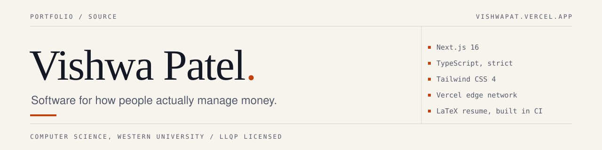

<div align="center">

<picture>
  <source media="(prefers-color-scheme: dark)" srcset=".github/assets/banner-dark.svg">
  
</picture>

<br />

[](https://github.com/Vishwapat/portfolio/actions/workflows/ci.yml)
[](https://github.com/Vishwapat/portfolio/actions/workflows/codeql.yml)
[](https://scorecard.dev/viewer/?uri=github.com/Vishwapat/portfolio)
[](LICENSE)

**[vishwapat.vercel.app](https://vishwapat.vercel.app)**

</div>

## About

The personal site of Vishwa Patel, a Computer Science student at Western University
who builds full stack software and ships it to production standards. It is built like production software: typed
content, static rendering, automated accessibility checks, and a resume typeset in
LaTeX and compiled in CI.

## Stack

| Layer     | Choice                                  | Why                                                       |
| --------- | --------------------------------------- | --------------------------------------------------------- |
| Framework | Next.js 16, App Router, React 19        | Static rendering by default, file based routing           |
| Language  | TypeScript, strict, typed routes        | Broken links and props fail the build, not the visitor    |
| Styling   | Tailwind CSS 4 with CSS variable tokens | One palette definition drives light and dark themes       |
| Images    | `next/image`, AVIF then WebP            | Responsive sizes, lazy loading, blur placeholders         |
| Hosting   | Vercel, Git integration                 | Every push to `main` ships; every PR gets a preview URL   |
| Telemetry | Vercel Web Analytics and Speed Insights | Cookieless, real user Core Web Vitals                     |
| Testing   | Vitest, Playwright, axe-core            | Unit, end to end on Chromium and iPhone WebKit, a11y gate |
| Resume    | LaTeX (`latexmk`), FontAwesome icons    | Pixel exact, ATS readable, versioned with the site        |

## Getting started

```bash
nvm use        # Node 22
npm ci
npm run dev    # http://localhost:3000
```

| Script                 | What it does                                         |
| ---------------------- | ---------------------------------------------------- |
| `npm run dev`          | Dev server with Turbopack                            |
| `npm run build`        | Production build                                     |
| `npm run validate`     | Lint, typecheck, format check, unit tests            |
| `npm run test:e2e`     | Playwright on desktop Chromium and iPhone 15 Pro     |
| `npm run resume:build` | Compile `resume/resume.tex` into `public/resume.pdf` |

## Project structure

```text
.
├── .github/          workflows, templates, CODEOWNERS, dependabot
├── e2e/              Playwright specs (routing, a11y, mobile)
├── public/           static assets, including resume.pdf
├── resume/           LaTeX source for the resume
└── src/
    ├── app/          routes, layouts, metadata, OG images
    ├── components/   UI, split by concern
    ├── config/       site identity and navigation
    ├── content/      typed data for projects and experience
    └── lib/          small pure helpers, unit tested
```

## Deployment

Vercel's GitHub integration builds every commit. Pushes to `main` deploy to
production at [vishwapat.vercel.app](https://vishwapat.vercel.app); pull requests get
a preview deployment linked in the PR. GitHub Actions runs quality gates in
parallel, so a red check is visible before anything is merged.

## Quality gates

- **CI**: ESLint with zero warnings, `tsc --noEmit`, Prettier, Vitest, production build, Playwright with axe
- **Security**: CodeQL, OpenSSF Scorecard, dependency review, SHA pinned actions, secret scanning
- **Hygiene**: Conventional Commits enforced by commitlint and the PR title check, Dependabot weekly

## Contributing

Bug reports and accessibility fixes are welcome. Read [CONTRIBUTING.md](CONTRIBUTING.md)
and the [code of conduct](CODE_OF_CONDUCT.md). Report vulnerabilities privately as
described in [SECURITY.md](SECURITY.md).

## License

Code is [MIT](LICENSE). Personal content (copy, photos, resume) is all rights reserved.
